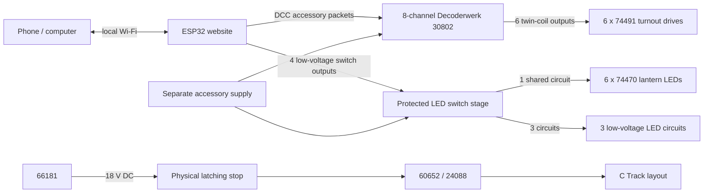

# Märklin C Track ESP32 Controller: Research and Proposed Design

Research date: 2026-10-26

This note records hardware facts relevant to the proposed system: six 74491 turnout drives, six turnout lanterns, three low-voltage LED lighting circuits, an ESP32-hosted website, and a separate physical latching train-power stop. The Märklin 66181 is to remain dedicated to the existing 60652/24088 train-control setup during the accessory prototype.

## Verified manufacturer facts

### Turnout drives

- Märklin 74491 is a C Track electric turnout mechanism using a **double solenoid**. Märklin says it has end shut-off contacts, can be controlled by an accessory controller or by decoder 74462, and can retain its hand lever. Märklin also lists feedback as possible with accessory controllers 7271/72710. [Märklin 74491](https://www.marklin.com/products/details/article/74491)
- Märklin does **not** publish the 74491 coil's operating current, minimum pulse duration, or recommended maximum energization time on the product page. Do not infer those values from the 74462 output rating.
- The 74462 decoder specifications give a maximum turnout output load of **2 A**, a maximum external voltage of **20 V DC**, and a maximum digital-circuit voltage of **20 V RMS**. These are limits for that decoder, not a published measurement of the 74491 coil current. [Märklin 74462 page](https://www.marklin.com/products/details/article/74462); [Märklin C Track instructions identifying the built-in decoder as a 74462](https://static.maerklin.de/damcontent/f5/60/f560437c4f8ee5f85cbd0e322b6cb0121669986548.pdf)

### Turnout lanterns

- The 74470 kit supplies LED lantern lighting for two C Track turnouts and Märklin says it is compatible with turnouts fitted with the 74491 drive. [Märklin 74470](https://www.marklin.com/products/details/article/74470)
- Märklin's 74470 wiring sheet specifies **16 V AC/DC maximum** and shows yellow and brown conductors. Treat the 16 V ceiling as applying to these LEDs; do not place them directly across an 18 V supply. [Märklin 74470 instructions](https://static.maerklin.de/damcontent/ba/11/ba11afd3567dfa6da9a68276ff4f856b1583241692.pdf)
- The lantern is mechanically linked to the turnout. The agreed layout controls all six lantern LEDs together from one lighting output; their visible orientation follows turnout movement mechanically. Three additional LED lighting circuits have separate controls.
- Decoder 74462 documentation limits its lantern output to **100 mA**. That is a useful reference for an accessory output, but the independent supply arrangement still needs a current budget and suitable protection. [Märklin C Track instructions identifying the built-in decoder as a 74462](https://static.maerklin.de/damcontent/f5/60/f560437c4f8ee5f85cbd0e322b6cb0121669986548.pdf)

### Existing train power path

- Märklin describes feeder track 24088 as a connection for a transformer and up to two Mobile Stations 60652. It is the existing interface between the 60652 and this layout. [Märklin 24088](https://www.marklin.com/products/details/article/24088)
- Märklin's 66181 instructions specify 230 V AC mains input and **18 V DC, less than 1 A, maximum 18 VA** output. [Märklin 66181 instructions](https://static.maerklin.de/damcontent/c5/26/c526d73cd05c1131996dd3ed085c62a01434542110.pdf)
- Keep the 66181 in its current role supplying the 60652/24088 path. Its published output is not a suitable basis for powering six solenoid drives and the separate layout-lighting loads as well.

### ESP32 output pins

- The classic ESP32 datasheet gives 3.3 V GPIO characteristics and specified output current in the tens of milliamps (the stated source/sink figures vary by pin power domain and conditions). A GPIO is a logic signal, not a solenoid or lighting power output. [Espressif ESP32 datasheet](https://documentation.espressif.com/esp32_datasheet_en.html)

## Design implications and recommended constraints

These are engineering inferences from the facts above, not a Märklin-approved circuit design.

1. **Use a dedicated, enclosed, regulated low-voltage accessory supply.** Keep its outputs separate from the 66181 train-control supply. The supply should meet the chosen turnout driver and lighting voltage/current requirements; size it only after measuring the 74491 coil current and adding the LED loads.
2. **Do not drive any 74491 coil or LED circuit from an ESP32 pin.** Use a purpose-built driver stage between GPIOs and loads. For the twin-coil motors, that stage must safely switch inductive loads, tolerate the chosen supply voltage, and provide a defined off state during ESP32 reset or boot.
3. **Use pulse-limited, interlocked turnout commands.** The 74491's end shut-off contacts provide a mechanical/electrical end-stop feature, but they do not justify holding a coil on indefinitely. Use a hardware or independently enforced maximum pulse time, initialize all outputs off, and serialize turnout pulses until the supply/current budget is proven. The exact pulse width remains to be established by controlled tests with the actual drive and driver.
4. **Treat 2 A as a conservative interface design ceiling, not measured coil draw.** A driver channel should have adequate pulse-current, voltage, thermal, and inductive-transient ratings after the coil is measured. A driver array with a lower per-channel rating should not be selected just because it has enough GPIO channels.
5. **Keep the lantern circuit at or below 16 V AC/DC.** If the turnout supply is 18 V, use a separate regulated 16 V branch or other suitable current-limited arrangement for 74470 lanterns. The three additional LED circuits need their own voltage/current inventory before output hardware is chosen.
6. **Make the latching stop interrupt train-system low-voltage power, not household mains.** During the 60652 prototype stage, a DC-rated, latching switch can be placed in the 66181's low-voltage output path to the 24088/train controller, leaving the separately powered ESP32/accessories active. For a later command station, apply the same principle to the low-voltage feed for its track-power stage. Verify that resetting the stop does not cause unintended train motion; the agreed software re-arm and fresh-speed-command sequence must be enforced before normal operation.
7. **Fuse supply branches.** Size protection for each supply and branch from measured load and the selected wire/driver ratings. Do not use one undersized supply to feed both the track controller and turnout coils.

## Unresolved electrical checks before selecting a driver or supply

- Measure 74491 current during an ordinary throw and check its behavior with the proposed DC supply. The manufacturer product page does not publish coil current or pulse width.
- Confirm the exact 74470 lantern set and wiring configuration. Märklin says each kit serves two turnouts, so six lanterns require three kits; the LED wiring sheet's 16 V maximum applies.
- Count and identify the loads on each of the three additional lighting circuits (voltage, polarity, steady-state current, and any inrush/current-limiting already present).
- The lantern grouping is settled: all six switch together. Confirm whether the lanterns are already owned or still to be bought; Märklin describes the 74470 kit as lighting for two turnouts per kit.
- Bench-test the latching stop and reset behavior with the 60652 before relying on a power-cycle stop during the prototype; then repeat with the eventual open-source train-power stage.

## Sources

- Märklin, [74491 electric turnout mechanism](https://www.marklin.com/products/details/article/74491)
- Märklin, [74470 turnout lantern kit](https://www.marklin.com/products/details/article/74470) and [74470 wiring instructions](https://static.maerklin.de/damcontent/ba/11/ba11afd3567dfa6da9a68276ff4f856b1583241692.pdf)
- Märklin, [74462 turnout decoder specifications](https://www.marklin.com/products/details/article/74462) and [C Track instructions with 74462 electrical limits](https://static.maerklin.de/damcontent/f5/60/f560437c4f8ee5f85cbd0e322b6cb0121669986548.pdf)
- Märklin, [24088 feeder track](https://www.marklin.com/products/details/article/24088)
- Märklin, [66181 transformer/power-supply instructions](https://static.maerklin.de/damcontent/c5/26/c526d73cd05c1131996dd3ed085c62a01434542110.pdf)
- Espressif, [ESP32 datasheet](https://documentation.espressif.com/esp32_datasheet_en.html)
- Decoderwerk, [30802 product specification and price](https://www.decoderwerk.com/p/30802-weichendecoder-zur-steuerung-von-8-weichen-mit-magnetantrieben) and [30802 manual](https://decoderwerk.com/WebRoot/Store21/Shops/93914593/6274/F85F/0E02/56EE/8DE6/0A0C/6D0F/7B4D/3080202.pdf)
- ESPHome, [web server](https://esphome.io/components/web_server/), [Wi-Fi access-point mode](https://esphome.io/components/wifi/), and [web API](https://esphome.io/web-api/)
- ESP32 DCC++ project, [DCCppESP32 repository and documentation](https://github.com/WolfgangGitHub/DCCppESP32)
- ESP32 mfx project, [directMFX_ESP32 repository](https://github.com/BOBILLEChristophe/directMFX_ESP32)

## Open-source software and proposed architecture

The train branch changes only after a replacement command station has passed the separate-track acceptance tests. The emergency stop stays in the track-power branch and does not switch accessory power.

### Accessory controller

- ESPHome's web-server component exposes a browser interface plus REST and event APIs for viewing and controlling entities. Its Wi-Fi configuration can create an access point, and `web_server: local: true` embeds the required web assets so the interface does not fetch them from the internet. The web server supports authentication. [ESPHome web server](https://esphome.io/components/web_server/); [ESPHome Wi-Fi access point mode](https://esphome.io/components/wifi/); [ESPHome web API](https://esphome.io/web-api/)
- ESPHome is a plausible fast route for a one-turnout bench prototype. Its stock page is an entity dashboard, not a track diagram. A project-specific page with explicit straight/branch commands, reported commanded state, train controls, and emergency-stop status is better served by a small custom PlatformIO firmware and a locally embedded responsive web page. The repository already uses standalone PlatformIO projects under `projects/`.
- The proposed accessory web model is six turnout cards, each with explicit position commands and an `Unknown`/`Last commanded` indicator; one shared lantern-light switch; and three separately switched low-voltage LED circuits. On boot, all turnout positions are `Unknown`, outputs default off, and target commands only pulse a coil when the requested target differs from the last commanded target. The site labels this as commanded state, not physical feedback.
- A standalone ESP32 access point should use a WPA2 password. Embed all page assets in flash, expose no internet dependency, and require a password for the control page. The built-in ESPHome web server recommends authentication and a trusted network; it also documents that its external CSS/JavaScript defaults should be replaced with local assets for a standalone node. [ESPHome web-server security and local assets](https://esphome.io/components/web_server/)

### Off-the-shelf turnout driver candidate

- **Decoderwerk 30802** is a strong hardware candidate for the six existing 74491 twin-coil motors: one board has eight 3-terminal outputs, accepts DCC or Märklin Motorola signals, and is listed at **€40 including VAT plus shipping** by its manufacturer. The manual specifies a 12–24 V DC or 9–18 V AC / 12–24 V track supply, 9–24 V signal input, 2 A maximum per output and 2 A total, a 400 ms default pulse adjustable in 10 ms steps up to 2.55 seconds, optocoupled signal input, and internal overcurrent protection. [Decoderwerk product page](https://www.decoderwerk.com/p/30802-weichendecoder-zur-steuerung-von-8-weichen-mit-magnetantrieben); [manufacturer manual](https://decoderwerk.com/WebRoot/Store21/Shops/93914593/6274/F85F/0E02/56EE/8DE6/0A0C/6D0F/7B4D/3080202.pdf)
- This avoids a custom 12-channel high-current solenoid driver and leaves two turnout outputs spare. Keep turnout commands serialized because the decoder's total output limit is 2 A even though a single output is rated up to 2 A. Verify the default pulse reliably throws the actual 74491 drives; shorten the pulse only after bench checks.
- The ESP32 still needs to generate the DCC accessory signal and present the user's own local website. The open-source [DCCppESP32 project](https://github.com/WolfgangGitHub/DCCppESP32) is a possible DCC signal-generation base: it uses PlatformIO, supports ESP32 motor-driver boards, and has an LCC event path that emits DCC accessory packets. Its documented built-in web page is for locomotive control and station configuration, and the firmware's Wi-Fi configuration connects to an access point rather than creating the user's preferred control AP. The accessory website/AP integration therefore remains custom work; the DCC output should feed only the 30802 signal input, not the Märklin running rails. [DCCppESP32 source/readme](https://github.com/WolfgangGitHub/DCCppESP32)
- A direct GPIO/MOSFET driver remains a lower-cost possibility, but Märklin publishes no 74491 coil current or pulse data. Do not select that route until one drive has been measured and the driver, pulse limit, and fault behavior are designed around the result.

### Train controller

- Märklin identifies the 37921 as an **mfx** locomotive with a sound generator, Telex coupler, and a smoke-generator connection. Its product page lists functions including lights, sounds, Telex, and smoke. [Märklin 37921](https://www.marklin.com/products/details/article/37921)
- Märklin lists the 60652 as supporting up to nine auxiliary functions. This is useful during the accessory stage, but it does not prove that every function listed for the 37921 is accessible through the old controller. [Märklin 60652](https://www.marklin.com/products/details/article/60652)
- The public [directMFX_ESP32 project](https://github.com/BOBILLEChristophe/directMFX_ESP32) is licensed AGPL-3.0 and describes itself as in development. The README claims multi-locomotive mfx control and Wi-Fi/Ethernet interfaces, but the functions it explicitly describes as already usable are basic serial commands for power, locomotive address, speed, and direction. Treat it as an experimental candidate; do not assume the web interface, all 37921 functions, three-locomotive operation, or emergency-stop behavior are complete until verified on a separate test track.
- The repository README suggests an L293D or equivalent H-bridge and an approximately 18 V supply. That is not a validated sizing recommendation for three trains. Select the later track power stage only after measuring or otherwise bounding worst-case train current, then add a suitable current limit and short-circuit shutdown. The 66181 is specified below 1 A, so it should not be assumed to power the eventual three-train command station. [Märklin 66181 instructions](https://static.maerklin.de/damcontent/c5/26/c526d73cd05c1131996dd3ed085c62a01434542110.pdf)

### Suggested phases

1. **Verify one turnout and one lantern.** Connect one 74491 to one 30802 output, check the wiring with power disconnected, then test the default 400 ms pulse at a regulated supply within the manufacturer's range. Separately verify the lantern at a regulated voltage below 16 V.
2. **Build a one-turnout accessory prototype.** Use an ESP32 local access point, browser controls, a DCC output stage, one 30802 output, and one separately protected LED switch. Keep the DCC signal bus isolated from the running rails.
3. **Scale the accessory controller.** Add the remaining five turnout drives, the shared six-lantern circuit, and three lighting circuits after checking all loads and adding branch fuses. Keep the 66181 dedicated to the 60652/24088 path.
4. **Validate train control separately.** On a separate test track, verify registration/addressing, independent control of multiple locos, direction and speed, every 37921 function, Wi-Fi disconnect/reconnect behavior, and the latching emergency stop. Keep the 60652 until the whole acceptance list passes.

## Cost and procurement notes

- Märklin currently lists one 74462 decoder at €44.99 RRP. Six would total **€269.94** before any control station or wiring. It is a useful certified reference, but it is not the cheap direct-GPIO route. [Märklin 74462](https://www.marklin.com/products/details/article/74462)
- The Decoderwerk 30802 manufacturer lists the 8-output magnetic-accessory decoder at **€40 including VAT plus shipping**. It is cheaper than six 74462s, but still needs an ESP32 DCC output stage and website integration. [Decoderwerk product page](https://www.decoderwerk.com/p/30802-weichendecoder-zur-steuerung-von-8-weichen-mit-magnetantrieben)
- A direct GPIO/MOSFET driver bank could be cheaper still, but a responsible price and exact module choice cannot be fixed until actual coil current and pulse requirements are measured. Do not select a generic relay/MOSFET board by channel count alone.
- The 66181's 18 V output exceeds the 74470 lantern's 16 V maximum and has less than 1 A capacity. It must not be repurposed as the accessory supply.
